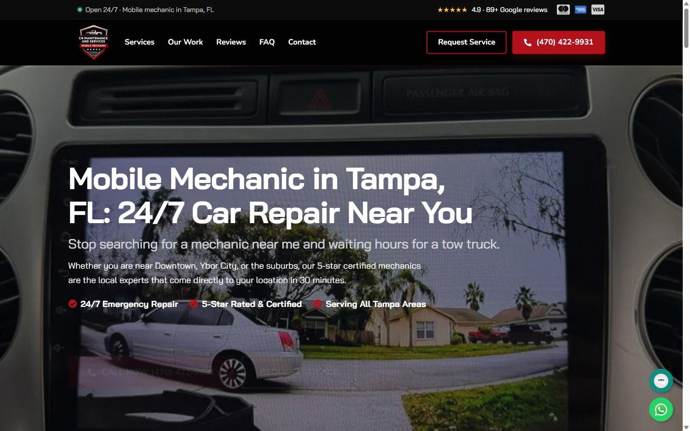
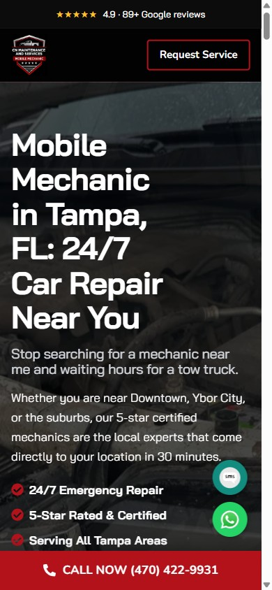

    

  
  &nbsp;
  

## Qué es

CN Maintenance es un mecánico a domicilio en Tampa, Florida: reparaciones, mantenimiento, frenos, transmisiones y detailing donde esté el cliente.

## Qué se hizo

- **Tema de WordPress propio**, en lugar del sitio anterior hecho con Elementor. Pesa menos, carga más rápido y usa fotos propias en WebP.
- **SEO local para Tampa**: páginas de servicio, schema `AutoRepair`, sitemap y `llms.txt`.
- **Cotizaciones por formulario y WhatsApp**, con llamada en un toque desde el celular.
- **CN Garage**, una app web dentro del mismo sitio para registrar clientes y vehículos. Tiene un panel por roles y un enlace para que cada cliente vea el estado de su carro.

## Resultados

- **4.9 ★ con 89 reseñas en Google**, mostradas en la web y sincronizadas con el schema.
- El taller pasó de tener solo una web a manejar a sus clientes con su propio sistema.

---

Hecho por <a href="https://prismadevelop.com/">Prisma Develop</a> · El código es privado: este repo solo muestra el trabajo.

